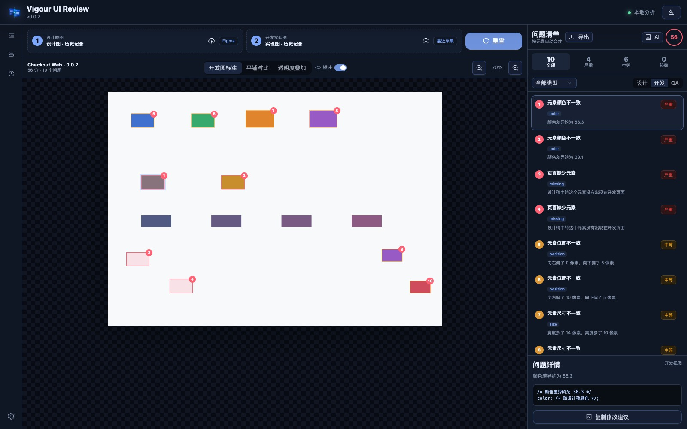

# Vigour UI Review

[English](README.md) · [产品 SPEC](docs/spec/PRODUCT_SPEC.md) · [技术架构](docs/architecture/TECHNICAL_ARCHITECTURE.md) · [安全说明](docs/SECURITY.md)

Vigour UI Review 是一款本地优先的 Web 设计验收工作台。它将开发实现图与设计源进行对齐，检测位置、尺寸、颜色、缺失、多余及可选 OCR 文字差异，并转换为可复核的问题和可导出的证据。

> 更新于 2026-10-13：**v0.0.2 开发候选版本已提交到 [PR #10](https://github.com/lukidesign/Vigour-UI-Review/pull/10)**，源码验证与 Windows 打包 CI 均通过。GitHub 正式 Releases 仍为 **v0.0.1**；新版 macOS 安装器已在本地重新打包并验证。

## v0.0.2 开发进展

以下更新位于[开发分支](https://github.com/lukidesign/Vigour-UI-Review/tree/codex/windows-11-x64-beta)，正在 PR #10 中等待合并：

- 项目栏默认收起，更新产品 Logo 与版本展示，缩放图标居中，并区分首次走查与重新走查。
- 开发图标注、平铺对比、透明度叠加均支持问题标注，可统一显示/隐藏，点击标注可定位问题清单。
- 导出和 AI 入口集中到问题清单头部；问题解释与组件业务逻辑推断共用弹窗，根据任务展示说明、结果及单次发送确认。
- 引导式本地连接恢复、Native Messaging 按需启动与一次性工作台配对。
- 重新构建 macOS Apple Silicon 离线配套程序、图形安装器，以及 Windows 11 x64 未签名内测候选包。

**这些更新尚未包含在 v0.0.1 下载包或 main 的应用源码中。** 请使用同一次构建中的配套扩展和本地程序。

### 下载与构建状态

| 版本 / 平台 | 当前状态 | 获取方式 |
| --- | --- | --- |
| v0.0.2 源码 | 开发分支，PR #10 待合并 | [查看源码](https://github.com/lukidesign/Vigour-UI-Review/tree/codex/windows-11-x64-beta) |
| v0.0.2 Windows 11 x64 | 未签名内测安装器及匹配扩展，CI 通过 | [下载 Actions 附件](https://github.com/lukidesign/Vigour-UI-Review/actions/runs/38237762236/artifacts/11740879600) |
| v0.0.2 macOS Apple Silicon | 离线程序与图形安装器已在本地重新构建并验证 | 暂无公开的 v0.0.2 macOS 下载链接 |
| v0.0.1 macOS Apple Silicon | 旧版未签名开发者预览包 | [已发布版本](https://github.com/lukidesign/Vigour-UI-Review/releases/tag/v0.0.1) |

Windows 附件需要登录 GitHub，保留期为三天；过期后请在 [PR #10](https://github.com/lukidesign/Vigour-UI-Review/pull/10) 查找更新的成功构建。安装前请阅读 [Windows 内测指南](https://github.com/lukidesign/Vigour-UI-Review/blob/codex/windows-11-x64-beta/docs/WINDOWS-TESTER-GUIDE.md)。Windows 11 普通用户真机与 Chrome 完整流程仍待验收。

### 验证记录 · 2026-10-12

- 127 项 JS/TS 测试、11 项 Python 测试、类型检查与生产构建通过。
- 50 对合成图片的 500 处已标注差异全部匹配；该结果不代表真实业务页面的生产准确率。
- macOS 整包完整性与私有路径检查、离线分析、Native 集成，以及隔离安装、更新、回退、修复和卸载测试通过。
- [GitHub CI](https://github.com/lukidesign/Vigour-UI-Review/actions/runs/38237762236) 完成源码验证、生产依赖审计、Windows 离线分析与凭据/Native 烟测，以及图形安装器打包。

详细证据见 [v0.0.2 交付记录](https://github.com/lukidesign/Vigour-UI-Review/blob/codex/windows-11-x64-beta/docs/DELIVERY-STATUS.md)和[变更记录](https://github.com/lukidesign/Vigour-UI-Review/blob/codex/windows-11-x64-beta/CHANGELOG.md#unreleased)。安装器仍未签名；macOS 公证、干净机器安装、真实 Chrome 采集和休眠/空闲行为仍待验收。商店草稿 ID `dmkfgmpbomjjhalgnfhcpalobdnklchh` 不代表上架或审核通过。



*上图为使用合成演示数据的早期工作台截图，尚未展示上述 v0.0.2 界面优化。*

## 核心能力

- OpenCV/PaddleOCR 本地分析，检测和评分不依赖 AI。
- Chrome Manifest V3 当前视口和整页采集。
- 开发图标注、平铺对比、透明度叠加三种模式。
- 项目导航、对比画布、问题清单固定三栏工作台。
- 像素级大白话问题描述、严重程度和同元素分组。
- PNG、Markdown、JSON 导出。
- 使用最小权限 PAT 导入指定 Figma Frame。
- 可选 OpenAI、Gemini、Kimi、DeepSeek 解释，并使用一次性同意回执。
- 九套内置主题，以及自定义主题导入、编辑、复制和导出。
- 凭据存入 macOS 钥匙串，本地 API 只监听 `127.0.0.1`。

## 安装旧版 v0.0.1 预览包

1. 从 [GitHub Releases](../../releases/latest) 下载 `Vigour-UI-Review-v0.0.1-macos-arm64.zip` 和对应 `.sha256`。
2. 校验文件：

   ```bash
   shasum -a 256 -c Vigour-UI-Review-v0.0.1-macos-arm64.zip.sha256
   ```

3. 解压后，首次启动请按住 Control 点击 `start.command`，选择“打开”。`v0.0.1` 尚未签名。
4. 等待浏览器自动打开 `http://127.0.0.1:4179/`。OCR 首次冷启动可能需要约 30 秒。

安装 Chrome 采集扩展：打开 `chrome://extensions`，启用“开发者模式”，选择“加载已解压的扩展程序”，然后选择安装包中的 `chrome-extension/`。令牌配对和故障排查见[安装说明](docs/INSTALL.md)。

## 从源码运行

运行 v0.0.2 工作台及安装器更新前，请先切换到 `codex/windows-11-x64-beta` 分支。Windows 构建请使用 [Windows 构建说明](https://github.com/lukidesign/Vigour-UI-Review/blob/codex/windows-11-x64-beta/docs/WINDOWS-BETA-STATUS.md)。

环境要求：macOS 14+ Apple Silicon、Node.js 24+、pnpm 11+、[uv](https://docs.astral.sh/uv/)。

```bash
pnpm install --frozen-lockfile
uv sync --project apps/vision-engine --python 3.12 --extra dev --extra ocr --frozen
pnpm release:check
pnpm start:local
```

生成 macOS 离线包（v0.0.2 Native Host 还需要 Rust 编译器）：

```bash
pnpm package:dev
pnpm package:check
pnpm package:smoke
pnpm package:archive
```

依赖目录、虚拟环境、基准输出、构建产物和安装包均不会进入 Git。

## 合成演示数据

[`examples/demo`](examples/demo) 中的图片由程序生成，不包含任何真实用户或第三方产品数据。将 `design.png` 作为设计图、`implementation.png` 作为开发实现图上传，即可试跑本地流程。

## 隐私模型

核心对比完全离线，应用不包含遥测。Figma 与 AI 均为可选集成，使用用户自行提供的凭据。每次 AI 调用前，界面会明确展示供应商、模型、任务、问题范围和是否包含图片；同意回执十分钟后失效且只能使用一次。

运行数据位于：

```text
~/Library/Application Support/Vigour UI Review/
```

首次启动会将旧版 `Design Acceptance 2.0` 数据原子复制到新目录，同时保留旧目录用于恢复。详情见[隐私说明](docs/PRIVACY.md)和[安全说明](docs/SECURITY.md)。

## 已知限制

- 已发布的 v0.0.1 仅支持 macOS Apple Silicon；v0.0.2 增加 Windows 11 x64 内测候选包，普通用户真机安装尚待验收。目前没有 macOS Intel 构建。
- 开发者安装包尚未签名和 notarization。
- Chrome 扩展尚未上架 Chrome Web Store。
- 界面以中文为主，英文商店文案不代表英文界面已完成。桌面宽度 1920、1440 已有检查记录，900、720 仍有溢出。
- 当前是合成回归基准，仍需补充人工标注的真实页面盲测。
- Canvas、WebGL、视频内部、跨域 iframe 和交互回放不属于 `v0.0.1` 范围。

## 参与贡献

欢迎提交 Issue 和 Pull Request。请先阅读[贡献指南](CONTRIBUTING.md)和[行为准则](CODE_OF_CONDUCT.md)。安全漏洞请按照[安全说明](docs/SECURITY.md)私密报告。

## 许可证

Copyright © 2026 LukiDesign。基于 [MIT License](LICENSE) 开源。
